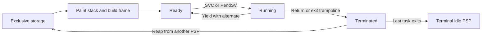

# M4 task context

The portable table in `kernel/src/task` owns task IDs, names, state and
architecture-provided contexts. The firmware instantiates it with eight slots.
Its platform context contains an exclusive stack loan, saved PSP, entry and
argument. A slot starts in Ready. Only a handoff can make it Running. A yield
makes it Ready again if an alternate exists. Exit makes it Terminated.
The table allows one Running ID. Reaping vacates the slot and returns the
stack to the caller. A generation increments on reuse. Generation exhaustion
retires the slot permanently.

## Storage and ownership

Use exclusive static buffers with an 8-byte-aligned base and end and at least
512 bytes. Application workers reserve 1,024 bytes each; the idle validation
task reserves 2,048 bytes for formatting and console work. M3 pool and TLSF
regions are separate. The scoped validation reuses an exited worker's storage
for a replacement and checks stale IDs and duplicate reaping. A full table
returns the loan. An undersized or misaligned buffer is rejected before
initialization. The linker orders and bounds static data, the emergency
stack, pool, heap and MSP. The task buffers are aligned objects inside .bss
and are counted once as part of static SRAM.

Task stacks grow down. The M3 fill and guard words allow an approximate peak
estimate and canary detection. The runtime checks both guards and bounds the
saved pointer before a software stack write or restore. A watermark samples
only a non-running task and scans below its saved frame. A guard may be
overwritten after damage has already propagated without an MPU. Exception
entry itself can already have written to RAM before PendSV checks the PSP.
Watermark estimates can miss writes that match the fill pattern.

## Cortex-M3 layout and exception paths

| Offset from saved PSP | Content |
|---:|---|
| 0–28 | R4–R11, ascending |
| 32–48 | R0, R1, R2, R3, R12 |
| 52 | LR, Thumb exit trampoline for a new task |
| 56 | Even PC within linker-defined executable code |
| 60 | xPSR with T set and a zero Thread Mode exception field |
| 64 | Optional hardware alignment word when stacked xPSR bit 9 is set |

New frames have no padding. First-task arguments are in R0. The SVC handler
accepts Thread/MSP EXC_RETURN `0xFFFFFFF9` and verifies a one-shot armed
runtime. It restores the first software frame, sets PSP, resets MSP to
the linker top and returns with `0xFFFFFFFD`. Hardware re-enters privileged
Thread Mode with SPSEL selecting PSP. The MSP-only bootstrap does not resume.
SVC runs unmasked at priority 8. PendSV is priority 15 and SysTick is 14.

PendSV returns immediately from an MSP entry. For a task entry it reads PSP
and pushes two words to keep MSP aligned and preserve EXC_RETURN over the Rust
selector. The selector validates the outgoing allocation and hardware frame,
then validates the incoming saved image. R4–R11 survive the selector call by
AAPCS and remain untouched until the assembly writes them to the outgoing
stack. Assembly restores R4–R11, publishes PSP, executes ISB and returns using
the original EXC_RETURN. The IRQ test software-pends DMA1 Channel 2 at priority
3, outside the table borrow, so it can nest in PendSV. The DMA channel itself
is never enabled. Normal switching performs no allocation or UART work.

## API and safe execution

- Create, query and reap are Thread Mode operations. Creation returns the
  exclusive buffer with an error. Reap requires Terminated, after PSP switched
  away. Inspection rejects Running. Idle is terminal and rejects new tasks.
- Start needs privileged, unmasked Thread/MSP and at least one Ready task.
  Startup stores all task inputs outside MSP and does not rely on live
  bootstrap destructors. Success never returns.
- Yield and the exit trampoline require unmasked privileged Thread Mode,
  with PRIMASK, BASEPRI and FAULTMASK clear. Dropping a table borrow always
  precedes any request. Requests coalesce in PendSV. A yield without an
  alternate resumes the same frame, leaving counters and state unchanged.
- PRIMASK masks configurable interrupts only during the bounded runtime
  borrow. NMI and HardFault are terminal and do not access the task table.
  SysTick owns its independent atomic timebase. Application tasks must
  release any resource whose owner cannot be suspended before yielding.
- Invalid frames publish a rejection code before terminal diagnostics.
  `M4_REJECTED_CONTEXT` codes are 1 for outgoing, 2 for incoming, 3 for first.
  `M4_COMPLETE=0x4d345041` means the normal validation reached terminal idle
  after its checks. Neither symbol is part of a stable firmware ABI.

The runtime borrows only TCBs while task stacks remain raw exclusive loans.
The architecture reads checked, initialized hardware words using volatile
access, and writes the initial frame before it can be published. The selector
never returns a pointer outside the bound stack. The assembly performs only
aligned software frame transfers. Once the assembly accepts a next PSP,
interrupts may nest but cannot touch the table or reclaim its old PSP. These
invariants allow reaping from a later task or idle. Interrupt mask state and
system exception priorities belong to the runtime and are shared globally.
There is no per-task FPU or interrupt-mask state.

## M5 integration

Keep the frame ABI, bounds checks, deferred reclamation and low-priority
PendSV entry. Replace the bounded slot scan with M5's policy only after M4
board acceptance. Keep IRQ wake and ready-queue rules explicit. M4 has no
blocking, timeout, priority or periodic preemption. Optional dynamic task
stacks are deferred. The TLSF build still exercises the M3 allocator on boot.
